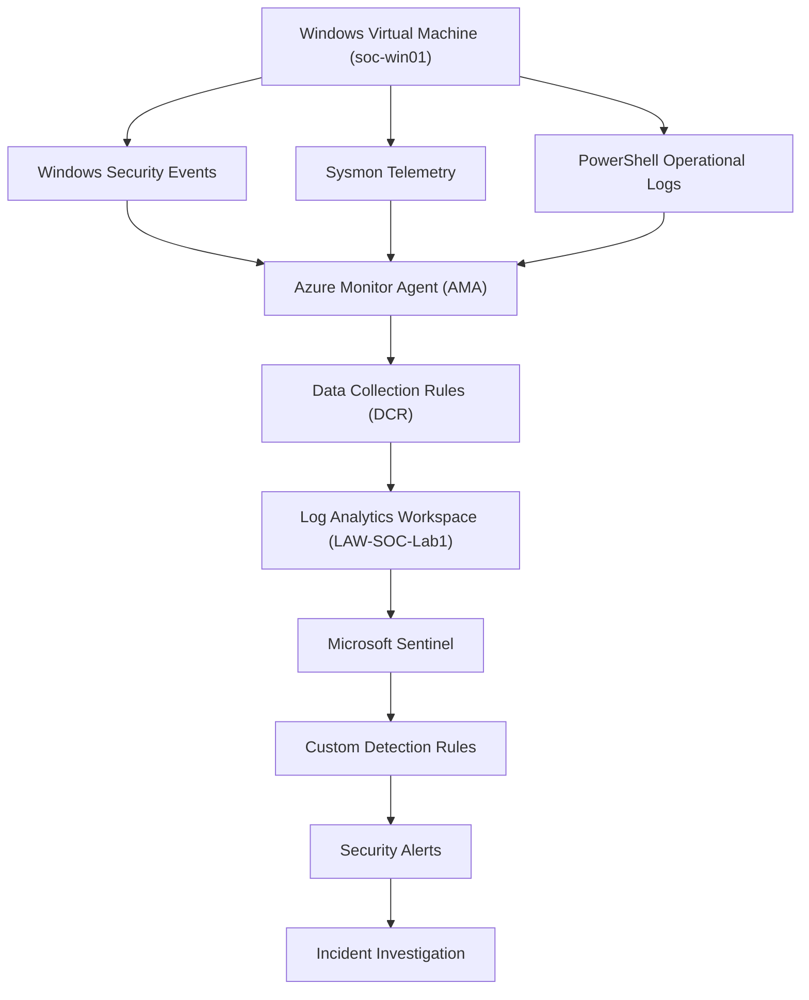

# SOC Architecture

## Overview

The Azure Mini-SOC Lab was designed to simulate a cloud-based Security Operations Centre (SOC), providing a centralised environment for collecting, monitoring and investigating security events.

The architecture uses an Azure-hosted Windows virtual machine as the monitored endpoint. Security telemetry is collected using the Azure Monitor Agent (AMA) and forwarded to an Azure Log Analytics workspace through configured Data Collection Rules (DCRs).

Microsoft Sentinel uses the collected telemetry to support security monitoring, custom detection rules and alert generation.

## Architecture Diagram

## Core Components

| Component | Description |
|---|---|
| Virtual Machine | Hosts the simulated Windows endpoint used to generate security activity. |
| Azure Monitor Agent (AMA) | Collects configured telemetry from the virtual machine. |
| Data Collection Rules (DCR) | Define which events are collected and where they are sent. |
| Log Analytics Workspace | Central repository for collected security telemetry and log analysis. |
| Microsoft Sentinel / Defender | Provides SIEM capabilities, detection rules and security alerting. |
| Sysmon | Provides additional endpoint telemetry for investigating system activity. |

## Security Monitoring Workflow

1. Simulated security activity is generated on the Windows virtual machine.
2. Windows Security Events, Sysmon and PowerShell logs provide endpoint telemetry.
3. Azure Monitor Agent collects the configured event data.
4. Data Collection Rules control the collection and routing of telemetry.
5. Events are ingested into the Log Analytics workspace.
6. Microsoft Sentinel uses the collected data to evaluate custom detection rules.
7. Matching activity generates security alerts for investigation.
8. Alerts are analysed and documented with recommended response actions.

## Design Objectives

The architecture was designed to demonstrate:

- Centralised security event collection.
- Endpoint monitoring and visibility.
- Cloud-based SIEM implementation.
- Custom threat detection and alert generation.
- Security event analysis and incident investigation.

