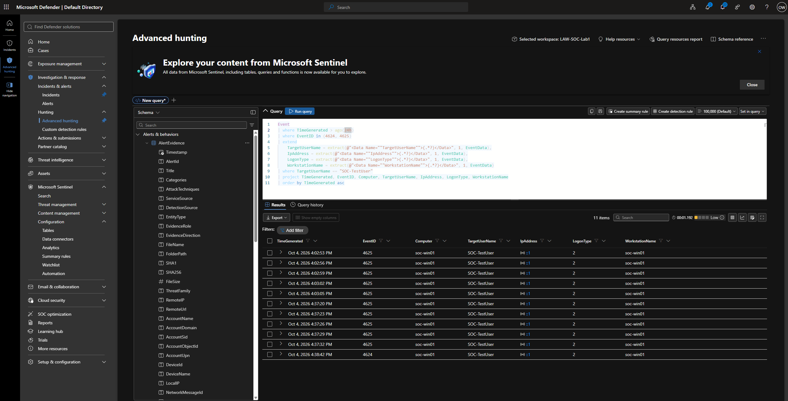
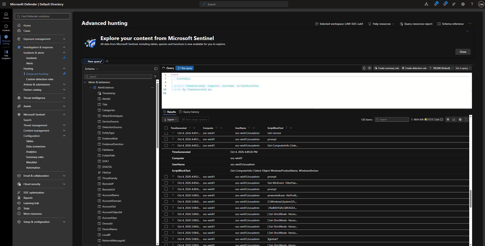
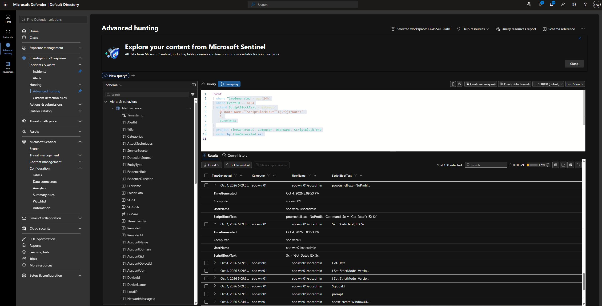
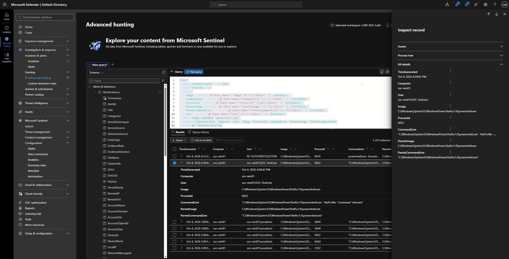
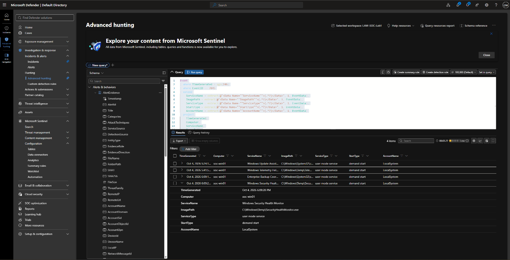

# Incident Investigation: Suspected Brute Force, PowerShell Execution and Service Persistence

> **Incident ID:** `SOC-LAB-INC-001`  
> **Severity:** High  
> **Disposition:** Benign Positive – suspicious activity was detected, but the activity was intentionally simulated in the lab  
> **Affected endpoint:** `soc-win01`  
> **Account:** `SOC-TestUser`  
> **Detection platform:** Microsoft Defender / Microsoft Sentinel  
> **Investigation date:** 04/10/2026

## 1. Executive Summary

Multiple security alerts were correlated on the Windows endpoint `soc-win01`. The activity began with repeated failed authentication attempts against `SOC-TestUser`, followed by a successful authentication. Subsequent PowerShell activity was observed, including script content matching suspicious execution indicators. Process telemetry associated the activity with `powershell.exe`, and a Windows service was later created with an executable located in a temporary directory.

The overall sequence was consistent with a simulated attack chain involving credential guessing, command execution and attempted persistence through a Windows service.

The activity was intentionally generated as part of a controlled SOC detection exercise. The detections identified the simulated behaviours as expected. The incident is therefore assessed as a **Benign Positive**, rather than a false positive.

## 2. Incident Details

| Field | Details |
|---|---|
| Incident ID | `SOC-LAB-INC-001` |
| Title | Suspected Brute Force > PowerShell > Service Persistence |
| Severity | High |
| Device | `soc-win01` |
| Account | `SOC-TestUser` |
| Source IP | `127.0.0.1` |
| Associated process | `powershell.exe` |
| Process ID | `6424` |
| Service | `Security Health Monitor` |
| Service executable | `C:\Windows\Temp\SecurityHealthMonitor.exe` |
| Detection source | Microsoft Defender / Microsoft Sentinel |
| Investigation date | 04/10/2026 |
| Disposition | Benign Positive – simulated lab activity |

The source IP `127.0.0.1` is the loopback address. In this lab, the authentication activity was generated locally; it should not be interpreted as evidence of a remote source.

## 3. Alerts Reviewed

Six detection scenarios contributed to the investigation.

| Detection | Severity | Event ID(s) | Initial assessment |
|---|---:|---:|---|
| Multiple Failed Logons | Low | 4625 | Suspicious authentication activity |
| Failed Logons Followed by Successful Logon | Medium | 4625, 4624 | Potential successful compromise |
| PowerShell Execution | Low | 4104 | PowerShell activity observed |
| Suspicious PowerShell Execution | Medium | 4104 | Suspicious command execution |
| Windows Service Creation | Medium | 7045 | New service created |
| Suspicious Windows Service Creation | High | 7045 | Potential persistence |

## 4. Entities

| Entity | Value | Significance |
|---|---|---|
| User | `SOC-TestUser` | Account involved in the activity |
| Host | `soc-win01` | Affected endpoint |
| Source IP | `127.0.0.1` | Local source of authentication activity |
| Process | `powershell.exe` | Associated with suspicious execution |
| Process ID | `6424` | Used to correlate PowerShell activity with process creation |
| Service | `Security Health Monitor` | Newly created service |
| Service path | `C:\Windows\Temp\SecurityHealthMonitor.exe` | Temporary, user-writable executable location |

## 5. Investigation and Evidence

### 5.1 Authentication Investigation

The authentication investigation identified **10 failed login attempts** against `SOC-TestUser`, followed by a successful login.

- Event ID `4625` recorded the failed authentication attempts.
- Event ID `4624` recorded the subsequent successful authentication.
- The events were associated with `soc-win01` and the `SOC-TestUser` account.
- The sequence was consistent with the simulated credential-guessing stage of the exercise.



### 5.2 PowerShell Investigation

PowerShell Script Block Logging (Event ID `4104`) recorded script execution associated with `SOC-TestUser`.

The recorded script content included possible reconnaissance activity and a script containing `IEX` (Invoke-Expression). The associated process was `powershell.exe`.





### 5.3 Process Investigation

Sysmon process creation telemetry (Event ID `1`) was reviewed to examine the PowerShell process and its associated command line and parent process details.

The investigation identified PowerShell launching a process running `whoami`, which may indicate reconnaissance activity.

The process investigation also recorded Process ID `6424`, allowing the process activity to be associated with the PowerShell investigation.



### 5.4 Windows Service Investigation

Windows Event ID `7045` recorded service creation activity on `soc-win01`.

The investigation identified a service named **Security Health Monitor**, with an executable path pointing to:

`C:\Windows\Temp\SecurityHealthMonitor.exe`

The use of a temporary, user-writable directory was considered suspicious and consistent with the simulated persistence stage of the exercise.



## 6. Incident Timeline

| Time | Event | Evidence | Significance |
|---|---|---|---|
| 16:02–16:37 | Failed authentication | 10 × Event ID `4625` | Possible brute force or password guessing against `SOC-TestUser` |
| 16:38 | Successful authentication | 1 × Event ID `4624` | Successful logon following the failed attempts; potential account compromise indicator |
| 16:49 | PowerShell execution | Multiple Event ID `4104` events | PowerShell activity following authentication, including possible reconnaissance |
| 17:09 | Suspicious PowerShell execution | Multiple Event ID `4104` events | Script content included a command using `IEX` |
| 17:24–18:09 | Service creation activity | 4 × Event ID `7045` | Multiple services created on `soc-win01`; possible persistence activity |
| 18:09 | Suspicious service created | Event ID `7045` | Service executable pointed to a suspicious temporary location |

## 7. Impact Assessment

### What was affected?

- **Host:** `soc-win01`
- **Account:** `SOC-TestUser`
- **Potentially affected resources:** The activity occurred on the Windows endpoint and involved authentication, PowerShell execution and service creation.

### Potential impact

The observed sequence indicated potential compromise of a local user account, followed by command execution and attempted establishment of persistence through a Windows service.

No evidence of data exfiltration, lateral movement or destructive activity was observed within the available telemetry.

## 8. MITRE ATT&CK Mapping

| Technique | Name | Relevance to the investigation |
|---|---|---|
| [T1110](https://attack.mitre.org/techniques/T1110/) | Brute Force | Multiple failed authentication attempts against `SOC-TestUser` were detected, followed by a successful authentication attempt. This represented the simulated credential-guessing stage. |
| [T1059.001](https://attack.mitre.org/techniques/T1059/001/) | Command and Scripting Interpreter: PowerShell | PowerShell execution was observed following authentication. General PowerShell logging and suspicious PowerShell behaviour were detected using PowerShell logging and Sysmon process telemetry. |
| [T1543.003](https://attack.mitre.org/techniques/T1543/003/) | Create or Modify System Process: Windows Service | Windows service creation was detected following PowerShell activity. The suspicious service detection identified characteristics associated with persistence, including execution from a temporary, user-writable location. |

## 9. Recommended Response

The following actions were documented as the recommended response if equivalent activity were identified in a production environment.

### 9.1 Contain the affected account

1. Temporarily disable or restrict the affected user account.
2. Force a password reset and revoke active session tokens where appropriate.
3. Review authentication activity for the account across other endpoints and services.

### 9.2 Isolate the affected host

1. Isolate the affected endpoint from the network.
2. Preserve system state and relevant telemetry before making changes.
3. Prevent further lateral movement or execution while the investigation is underway.

### 9.3 Further investigation

1. Investigate PowerShell activity for execution, downloads, encoding or other suspicious behaviour elsewhere in the environment.
2. Investigate the Windows service and compare its creation timestamp with surrounding authentication and PowerShell activity.
3. Search for additional indicators across the endpoint and environment, including authentication activity, unusual network connections, downloads and activity involving other accounts or endpoints.

### 9.4 Eradication and recovery

1. Remove any unauthorised persistence mechanism.
2. Remove or quarantine suspicious files.
3. Reset compromised credentials.
4. Rebuild or restore the endpoint if the level of compromise cannot be confidently determined.
5. Continue monitoring the affected account and endpoint for recurrence.

## 10. Investigation Queries

The following KQL queries were used during the investigation.

### 10.1 Authentication Investigation

```kql
Event
| where TimeGenerated > ago(24h)
| where EventID in (4624, 4625)
| extend
    TargetUserName = extract(@"<Data Name=""TargetUserName"">(.*?)</Data>", 1, EventData),
    IpAddress = extract(@"<Data Name=""IpAddress"">(.*?)</Data>", 1, EventData),
    LogonType = extract(@"<Data Name=""LogonType"">(.*?)</Data>", 1, EventData),
    WorkstationName = extract(@"<Data Name=""WorkstationName"">(.*?)</Data>", 1, EventData)
| where TargetUserName == "SOC-TestUser"
| project TimeGenerated, EventID, Computer, TargetUserName, IpAddress, LogonType, WorkstationName
| order by TimeGenerated asc
```

### 10.2 PowerShell Investigation

```kql
Event
| where TimeGenerated > ago(24h)
| where EventID == 4104
| extend ScriptBlockText = extract(
    @"<Data Name=""ScriptBlockText"">(.*?)</Data>",
    1,
    EventData
)
| project TimeGenerated, Computer, UserName, ScriptBlockText
| order by TimeGenerated asc
```

### 10.3 Process Investigation

```kql
Event
| where TimeGenerated > ago(24h)
| where EventID == 1
| extend
    Image = extract(@"<Data Name=""Image"">(.*?)</Data>", 1, EventData),
    CommandLine = extract(@"<Data Name=""CommandLine"">(.*?)</Data>", 1, EventData),
    ProcessId = extract(@"<Data Name=""ProcessId"">(\d+)</Data>", 1, EventData),
    ParentImage = extract(@"<Data Name=""ParentImage"">(.*?)</Data>", 1, EventData),
    ParentCommandLine = extract(@"<Data Name=""ParentCommandLine"">(.*?)</Data>", 1, EventData),
    User = extract(@"<Data Name=""User"">(.*?)</Data>", 1, EventData)
| where Image contains "powershell.exe"
| project TimeGenerated, Computer, User, Image, ProcessId, CommandLine, ParentImage, ParentCommandLine
| order by TimeGenerated asc
```

### 10.4 Service Investigation

```kql
Event
| where TimeGenerated > ago(24h)
| where EventID == 7045
| extend
    ServiceName = extract(@"<Data Name=""ServiceName"">(.*?)</Data>", 1, EventData),
    ImagePath = extract(@"<Data Name=""ImagePath"">(.*?)</Data>", 1, EventData),
    ServiceType = extract(@"<Data Name=""ServiceType"">(.*?)</Data>", 1, EventData),
    StartType = extract(@"<Data Name=""StartType"">(.*?)</Data>", 1, EventData),
    AccountName = extract(@"<Data Name=""AccountName"">(.*?)</Data>", 1, EventData)
| project
    TimeGenerated,
    Computer,
    ServiceName,
    ImagePath,
    ServiceType,
    StartType,
    AccountName
| order by TimeGenerated asc
```

## 11. Verdict and Disposition

**Verdict: Benign / False Positive** was the initial wording in the investigation document. The final incident disposition was recorded as:

**Benign Positive – Suspicious activity / potential endpoint compromise, confirmed as simulated lab activity.**

The detections correctly identified the behaviours intentionally generated during the controlled exercise. The activity was not evidence of an actual compromise.

## 12. Final Incident Summary

The investigation demonstrated how multiple detections can be correlated to build a broader understanding of endpoint activity.

The sequence began with repeated failed authentication attempts against `SOC-TestUser`, followed by a successful authentication. PowerShell activity was then observed, including script content matching suspicious indicators and process telemetry showing execution of `whoami`. Finally, a Windows service was created with its executable located in a temporary directory.

Although the sequence was consistent with credential attack, command execution and service-based persistence behaviours, the activity was intentionally simulated. The incident was therefore closed as a **Benign Positive**.

The exercise demonstrated the value of combining authentication logs, PowerShell Script Block Logging, Sysmon process telemetry and Windows service creation events to investigate activity across multiple stages.

---

*All activity described in this report was intentionally simulated within the Azure Mini-SOC lab environment. Findings are limited to the telemetry collected during the exercise.*
